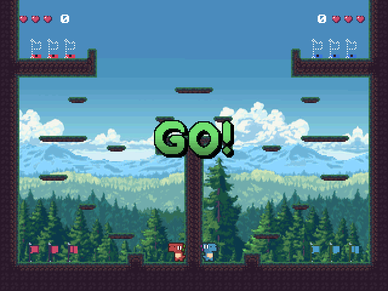
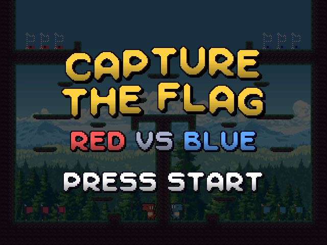
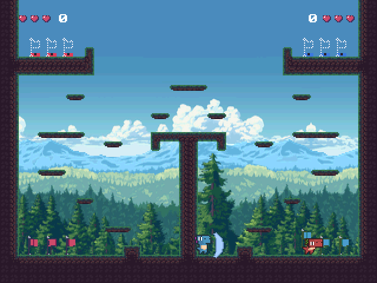
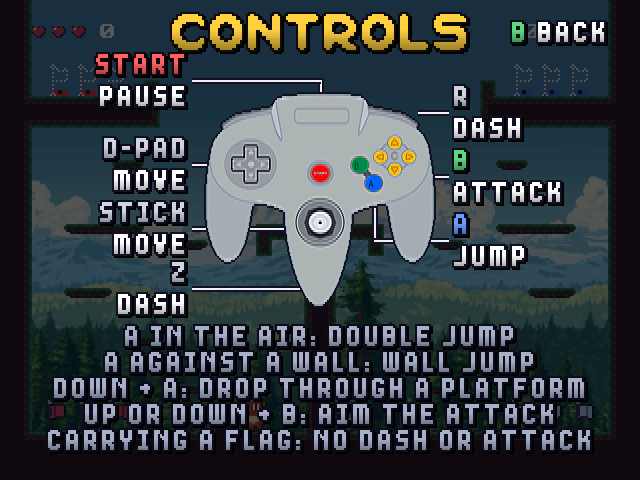
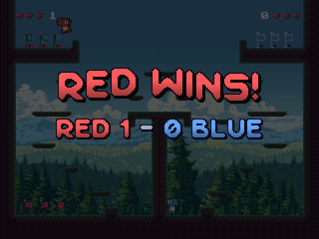

# Capture the Flag

A fast, fun two-player capture-the-flag game for the Nintendo 64. Built
with libdragon and SDL3, so the same game plays on the N64 and on PC.



| | |
|---|---|
|  |  |
|  |  |

## Play

**N64:** download `capture-the-flag.z64` from the
[latest release](https://github.com/gmcnaught/n64-capture-the-flag/releases/latest)
and run it on the MiSTer N64 core or in the ares emulator. Plug in two
controllers.

**PC:** build it from source (below) and run `make run`. Two players share
the keyboard, or plug in gamepads.

## How to play

Red against blue in one arena. Each team keeps three flags by its start.

- **Steal** the other team's flags and carry them, one at a time, up to
  your goal ledge. Get all three there to win the round.
- **Carriers** run slower and can't dash or attack. Kick a carrier and they
  drop the flag and go back to their start.
- **Defend:** grab your own dropped flag and carry it home.
- **Fight:** kick to knock off hearts; lose them all and you respawn.
- **Stack:** stand on your opponent to weigh them down, or land on them to
  stop their jump.
- **Water fruit:** now and then a fruit appears up top. Touch it and a
  stream of water pours down the platforms, sweeping up anyone in its way.

Every round starts with a 3, 2, 1, GO! countdown. Press Start to pause; the
pause menu has a CONTROLS screen. Pick the stage (Arena, Forest, Desert,
Snow, Lava) and the background on the title screen with up/down and
left/right.

## Controls

| Action | N64 | Gamepad | P1 keys | P2 keys |
|---|---|---|---|---|
| Move | Stick, D-pad | Stick, D-pad | WASD | Arrows |
| Jump (again in the air: double jump; at a wall: wall jump) | A | A (south) | Space | Right Shift |
| Attack (hold up or down to aim) | B | X (west) | F | / |
| Dash | Z, R | B (east), RB | Left Shift | . |
| Drop through a platform | Down + A | Down + A | S + Space | Down + Right Shift |
| Pause / menu | Start | Start | Enter | |

## Build

You need the libdragon toolchain (`preview` branch) at `$N64_INST`
(default `~/opt/libdragon`), SDL3 (`brew install sdl3 pkg-config` on
macOS), Python 3, and ares for the N64 tests.

```sh
make run          # build and play the PC version
make n64          # build the N64 ROM: platform/n64/ctf.z64
make test         # PC self-test and replay tests
make check        # the same tests on the N64, in ares
make deploy MISTER_HOSTS=<ip>   # copy the ROM to a MiSTer
```

The backdrops (forest, desert, moon and sky, picked on the title screen)
come from Bongseng's
[Parallax (Forest, desert, sky, moon)](https://bongseng.itch.io/parallax-forest-desert-sky-moon),
whose files can't be redistributed. Download it and unpack it into
`new-assets/more-parallax/` to build with it; without it every backdrop
is a mountain scene that is included.

The stages are levels in one [LDtk](https://ldtk.io) project
(`assets/src/levels/arena.ldtk`); each has its own layout, a Tileset field
and a Backdrop field. The ground tiles are built from the Collision layer
at import (`tools/terrain.py`: corners, edges and fill from each cell's
neighbors), so LDtk's own tile layers only show in the editor.

## How it works

One integer-only C99 core runs the game on both platforms: movement,
collision, flags and rounds. The N64 build draws it with libdragon at
640x240; the PC build draws the same frames with SDL3. Recorded replays
must produce identical results on PC and N64, which `make test` and
`make check` verify. Music is tracker modules, played by libdragon's xm64
player on the N64 and by libxm on PC.

```
core/              game logic shared by both platforms
platform/common/   shared renderer, replays, audio names
platform/host/     PC build (SDL3)
platform/n64/      N64 build (libdragon)
tools/             asset pipeline, level import, replay scripting
assets/src/        level and tileset
new-assets/        source art and music
tests/replays/     replay tests
```

Debug keys on PC: F1 collision overlay, F2 tuning panel, Backspace
restart, P freeze, N step a frame, F11 fullscreen.

## License

The code is under the [MIT License](LICENSE). Art, music and fonts are by
their creators under their own licenses; see [CREDITS.md](CREDITS.md).
